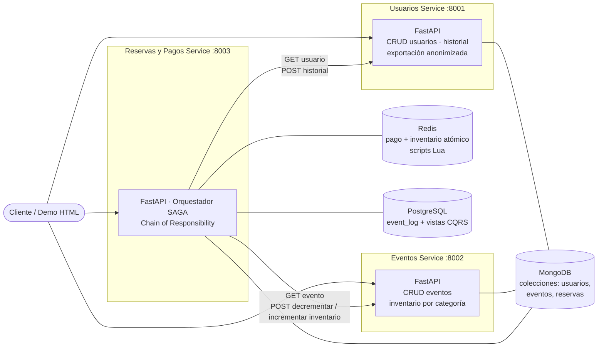
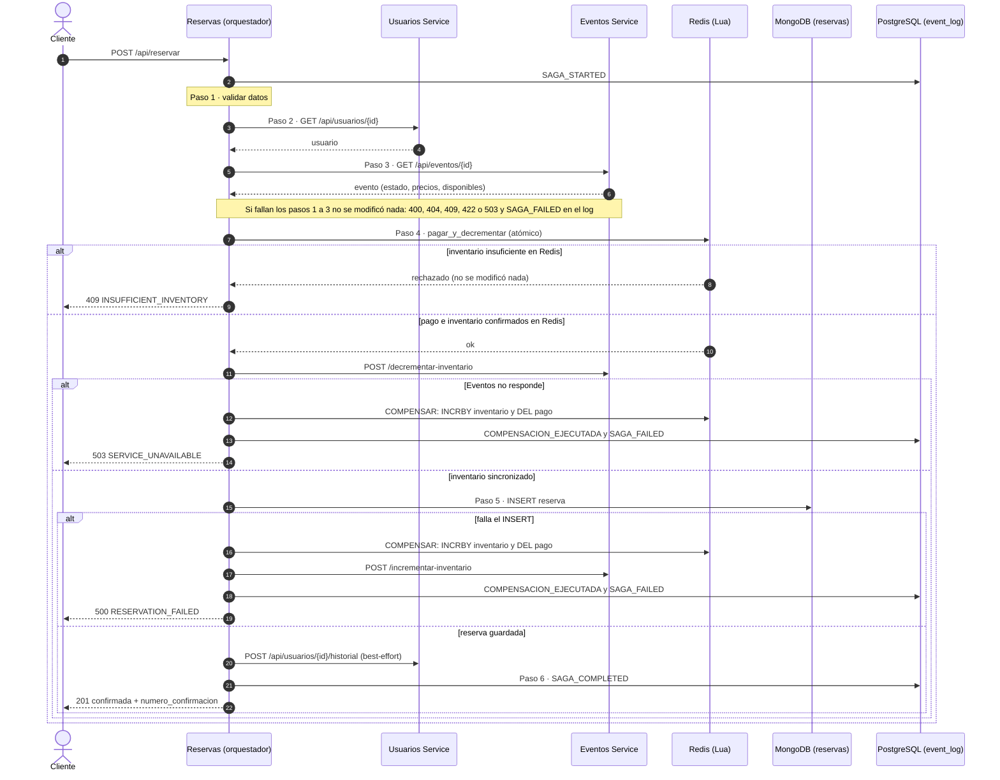
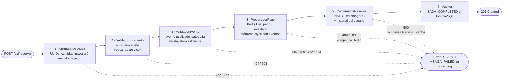

# EventFlow - Plataforma de Gestión de Eventos

> **Tarea 2 NoSQL** - Diseño e implementación de un sistema de microservicios con bases de datos políglotas, consistencia eventual/fuerte, y patrones SAGA + Chain of Responsibility.

---

## 🏗️ Arquitectura



Reservas es el único servicio que habla con los otros dos (por HTTP, con reintentos y circuit breaker); Usuarios y Eventos no se conocen entre sí. Cada servicio accede **solo a su propia colección** de MongoDB: la separación de datos es lógica (un único contenedor Mongo en el `docker-compose`), y el acceso a los datos de otro servicio es siempre por su API.

### Servicios

| Servicio | Puerto | Datos | Responsabilidad |
|----------|--------|-------|-----------------|
| **Usuarios** | 8001 | MongoDB (`usuarios`) | CRUD de usuarios, historial de compras, exportación anonimizada |
| **Eventos** | 8002 | MongoDB (`eventos`) | CRUD de eventos (fecha, lugar, aforo), inventario por categoría |
| **Reservas y Pagos** | 8003 | Redis + MongoDB (`reservas`) + PostgreSQL | Orquestador SAGA, pago e inventario atómicos, auditoría |

### Bases de datos

| BD | Tipo | Uso | Por qué |
|----|------|-----|---------|
| **MongoDB** | NoSQL documental | Usuarios, eventos y reservas confirmadas | Documentos con subdocumentos (historial, precios, ubicación), índices únicos, operadores atómicos sobre arrays |
| **Redis** | NoSQL clave-valor | Pago e inventario por evento/categoría | Scripts Lua atómicos y latencia de memoria: es lo que impide la doble venta |
| **PostgreSQL** | Relacional (complementaria) | `event_log` append-only y vistas analíticas | ACID para la auditoría; no cuenta como una de las dos NoSQL |

---

## 🧭 Justificación del Diseño

### 1. Consistencia distinta según la operación

| Operación | Prioridad | Cómo se logra | Estado en este repo |
|-----------|-----------|---------------|---------------------|
| Lecturas de usuarios y eventos (`GET`) | Disponibilidad y tolerancia a particiones → consistencia **eventual** | MongoDB con `readPreference=secondaryPreferred` | Configurado en ambos servicios. El `docker-compose` levanta **un solo nodo** Mongo (sin replica set), así que en desarrollo las lecturas van al primario; con un replica set se reparten en secundarios sin cambiar código. |
| Escritura de reservas y pagos | **Consistencia** → una reserva es única y no hay dobles ventas | Pago e inventario en un único script Lua de Redis, `_id = reserva_id` en Mongo, `writeConcern majority + journal` en `reservas` | Implementado y cubierto por tests (doble venta, concurrencia, idempotencia, compensaciones) |

Se sacrifica velocidad por consistencia solo donde el negocio lo exige (comprar); las lecturas, que son la mayoría, no pagan ese costo.

### 2. Bases NoSQL elegidas y asignación a servicios

- **Usuarios → MongoDB.** El perfil y su historial de compras forman un documento natural; hay consultas por `email` y `nro_documento` con índice único.
- **Eventos → MongoDB.** Documentos con `ubicacion` y `precios[]` anidados, leídos mucho y escritos poco; el inventario por categoría se actualiza de forma atómica con `$inc` + `arrayFilters` sobre el mismo documento.
- **Reservas y Pagos → Redis + MongoDB (+ PostgreSQL).** Redis ejecuta *pago + decremento de inventario* como una sola operación indivisible; MongoDB guarda la reserva confirmada (fuente de verdad idempotente); PostgreSQL registra cada paso como evento inmutable.
- Se descartaron Cassandra y DynamoDB: su modelo más restrictivo, o su dependencia de un proveedor, no aporta a esta escala.

### 3. Modelado: embebido vs referencia

| Relación | Patrón | Justificación |
|----------|--------|---------------|
| Usuario → `historial_compras[]` | **Embebido** | Se lee siempre con el perfil, cardinalidad baja por usuario y una sola escritura atómica. Cada compra guarda copia del `evento_nombre` y el `total_pagado` (desnormalización deliberada: el historial no depende de que el evento siga existiendo ni exige un *join* entre servicios). Si creciera sin límite pasaría a una colección propia. |
| Evento → `ubicacion`, `precios[]` | **Embebido** | Siempre se leen con el evento y no se comparten entre eventos; el inventario por categoría se modifica atómicamente dentro del mismo documento. |
| Reserva → usuario y evento | **Referencia** (`usuario_id`, `evento_id`) | Pertenecen a otros servicios, que son dueños de ese dato: se consultan por API y no se duplican. |
| Historial → reserva | **Referencia** (`reserva_id`) | Trazabilidad e idempotencia: reintentar la misma compra no la duplica. |

### 4. Por qué SAGA con orquestación

La compra toca tres servicios y tres bases distintas, así que no existe una transacción ACID distribuida. SAGA da consistencia con compensaciones explícitas. Se eligió **orquestación** (no coreografía) porque el flujo es secuencial y la compensación depende del paso que falla: un orquestador central (Reservas) lo hace explícito, testeable y auditable, y evita que Usuarios y Eventos tengan que conocerse. Solo los pasos 4 y 5 modifican estado; los pasos 1 a 3 son validaciones, por lo que fallan sin necesidad de compensar nada.

### 5. Por qué Chain of Responsibility

Cada validación o paso es un *handler* con una única responsabilidad; el orden se define en un solo lugar (`ChainBuilder`), un handler corta la cadena al fallar y agregar un paso no toca a los demás. Esto mantiene el orquestador simple y cada paso testeable en aislamiento.

### 6. No hay doble venta, y reintentar es seguro

- El script Lua `pagar_y_decrementar` verifica el stock, lo decrementa y registra el pago en una única ejecución; Redis procesa los scripts de a uno. Si dos clientes compran la última entrada a la vez, uno gana y el otro recibe `409 INSUFFICIENT_INVENTORY`.
- `reserva_id` (UUID) es la clave de idempotencia: el script usa la clave `pago:{reserva_id}` (si existe, no vuelve a descontar) y Mongo usa `_id = reserva_id`. Un reintento devuelve **200** con la reserva original en lugar de cobrar dos veces.
- Eventos-service aplica además `$elemMatch disponibles >= cantidad` al decrementar, como defensa adicional.

### 7. Event Sourcing y CQRS

Cada paso de cada SAGA, también las que fallan y se compensan, se guarda como evento inmutable en PostgreSQL (`event_log`, consultable en `GET /api/reservar/{id}/audit`). Las vistas SQL son el modelo de lectura analítico, separado del modelo operativo en MongoDB (ver [CQRS Analítico](#-cqrs-analítico-reservas-service)). A diferencia de guardar solo el estado final de la reserva en MongoDB, el log permite reconstruir qué pasó en cada intento y responder preguntas de negocio (ventas por evento, tasa de éxito, compensaciones) sin cargar al modelo operativo. Detalle en [`brain/patterns/event-sourcing-cqrs.md`](./brain/patterns/event-sourcing-cqrs.md).

---

## 🚀 Inicio Rápido

### Prerrequisitos
- Docker 24+ y Docker Compose 2.20+
- Make (opcional, para comandos simplificados)

### Construir, levantar y probar

```bash
# 1. Construir las imágenes de los 3 microservicios
make build                 # o: docker compose build

# 2. Levantar el stack (MongoDB, Redis, PostgreSQL + los 3 servicios)
make up                    # o: docker compose up -d --build

# 3. Verificar que los 3 servicios responden
make health

# 4. Correr los tests de los 3 servicios (dentro de los contenedores)
make test
```

`make up` reconstruye siempre (`--build`): sin eso, `docker compose up` reutiliza imágenes viejas aunque el código haya cambiado.

### Demo visual

Página HTML estática (sin build, sin dependencias) que llama a las tres APIs en vivo desde el navegador: crear usuario → crear evento → reservar (SAGA), con pipeline animado, idempotencia y un botón de error real. Ver [`demo/README.md`](./demo/README.md).

```bash
cd demo && python3 -m http.server 8080   # abrir http://localhost:8080
```

### Verificar que todo funciona

```bash
# Verificar health checks
make health

# O manualmente
curl http://localhost:8001/health  # Usuarios
curl http://localhost:8002/health  # Eventos
curl http://localhost:8003/health  # Reservas
```

### Ver logs

```bash
make logs           # Todos los servicios
make logs-svc SVC=eventos-service  # Servicio específico
```

### Detener

```bash
make down
```

---

## 📋 Endpoints Principales

### Usuarios Service (`http://localhost:8001`)

| Método | Endpoint | Descripción |
|--------|----------|-------------|
| POST | `/api/usuarios` | Crear usuario |
| GET | `/api/usuarios/{id}` | Obtener usuario |
| GET | `/api/usuarios` | Listar usuarios (paginado) |
| GET | `/api/usuarios/exportar` | Exportar anonimizado (GDPR) |
| POST | `/api/usuarios/{id}/historial` | Registrar una compra en el historial (uso interno: lo llama Reservas al confirmar; idempotente por `reserva_id`) |
| GET | `/health` | Health check |

**Ejemplo crear usuario:**
```bash
curl -X POST http://localhost:8001/api/usuarios \
  -H "Content-Type: application/json" \
  -d '{
    "tipo_documento": "DNI",
    "nro_documento": "12345678",
    "nombre": "Juan",
    "apellido": "Pérez",
    "email": "juan.perez@example.com"
  }'
```

### Eventos Service (`http://localhost:8002`)

| Método | Endpoint | Descripción |
|--------|----------|-------------|
| POST | `/api/eventos` | Crear evento |
| GET | `/api/eventos/{id}` | Obtener evento |
| GET | `/health` | Health check |

**Ejemplo crear evento:**
```bash
curl -X POST http://localhost:8002/api/eventos \
  -H "Content-Type: application/json" \
  -d '{
    "nombre": "Concierto Rock 2026",
    "estado": "publicado",
    "fecha": "2026-12-01T20:00:00Z",
    "aforo_total": 5000,
    "entradas_disponibles": 5000,
    "precios": [
      {"categoria": "VIP", "precio": 15000.00, "disponibles": 100},
      {"categoria": "General", "precio": 5000.00, "disponibles": 4900}
    ],
    "ubicacion": {
      "ciudad": "Buenos Aires",
      "pais": "Argentina",
      "direccion": "Estadio Luna Park"
    }
  }'
```

### Reservas Service (`http://localhost:8003`)

> **Nota:** el MVP no versiona la API — las rutas son `/api/reservar` sin
> prefijo `v1`, alineadas al contrato exacto de la tarea. `APIVersioningMiddleware`
> existe como código pero no está registrado en `main.py` (decisión consciente,
> YAGNI); ver `.specify/specs/003-reservation-payment/spec.md`.

| Método | Endpoint | Descripción |
|--------|----------|-------------|
| POST | `/api/reservar` | Iniciar SAGA reserva (idempotente por `reserva_id`) |
| GET | `/api/reservar/{id}` | Obtener reserva por ID |
| GET | `/api/reservar` | Listar reservas (paginado; filtros opcionales `usuario_id`, `evento_id`, `estado`) |
| GET | `/health` | Health check con dependencias |
| GET | `/metrics` | Métricas Prometheus |

**Ejemplo crear reserva:**
```bash
curl -X POST http://localhost:8003/api/reservar \
  -H "Content-Type: application/json" \
  -d '{
    "usuario_id": "550e8400-e29b-41d4-a716-446655440000",
    "evento_id": "550e8400-e29b-41d4-a716-446655440001",
    "cantidad": 2,
    "categoria": "general",
    "metodo_pago": "tarjeta"
  }'
```

**Resiliencia HTTP a Usuarios/Eventos Service** (`src/services/http_clients.py`):
- Reintentos: 3x con backoff exponencial (0.5s, 1s, 2s) ante timeout/error de red/5xx.
- Circuit breaker: `closed` → `open` tras 5 fallos consecutivos → `half-open` automático a los 30s (1 sola request de prueba) → `closed` si tiene éxito, `open` de nuevo si falla.

---

## 🏥 Health Checks

Todos los servicios exponen `/health` con 3 estados:

| Estado | Significado | HTTP |
|--------|-------------|------|
| `healthy` | Todo OK, latencia < 50ms | 200 |
| `degraded` | Latencia alta (50-500ms) | 200 |
| `unhealthy` | Dependencia caída | 503 |

**Respuesta ejemplo:**
```json
{
  "status": "healthy",
  "checks": {
    "mongodb": "ok",
    "redis": "ok",
    "postgresql": "ok",
    "usuarios_service": "ok",
    "eventos_service": "ok"
  },
  "service": "reservas-service",
  "version": "1.0.0",
  "timestamp": "2026-09-25T11:47:06.038620Z"
}
```

---

## 📊 Métricas Prometheus

Disponible en `/metrics` en cada servicio:

```bash
curl http://localhost:8002/metrics
```

Métricas expuestas:
- `http_requests_total` - Contador por método/endpoint/status
- `http_request_duration_seconds` - Histograma de latencia
- `http_requests_in_progress` - Requests en curso

---

## 🔄 Patrón SAGA (orquestación)



**Transacción exitosa:** (1) validar datos → (2) validar que el usuario existe → (3) validar evento (publicado, categoría válida, aforo) → (4) cobrar y decrementar inventario en Redis, y sincronizar el inventario con Eventos → (5) guardar la reserva en MongoDB → (6) auditar `SAGA_COMPLETED` en PostgreSQL. Después de guardar la reserva se agrega la compra al historial del usuario (*best-effort*: si Usuarios no responde, la reserva igual queda confirmada y se registra `HISTORIAL_PENDIENTE`).

**Transacciones de compensación** (cada paso que falla deshace lo que ya había modificado):

| Falla en | Ya modificado | Compensación | Respuesta |
|----------|---------------|--------------|-----------|
| Pasos 1 a 3 | Nada | Ninguna (falla rápido) | 400 / 404 / 409 / 422 / 503 |
| Paso 4: Redis rechaza (sin stock) | Nada (el script es atómico) | Ninguna | 409 `INSUFFICIENT_INVENTORY` |
| Paso 4: falla la sincronización con Eventos | Redis (pago + inventario) | Revertir Redis: `INCRBY` del inventario y `DEL` del pago | 503 `SERVICE_UNAVAILABLE` |
| Paso 5: falla el `INSERT` en MongoDB | Redis y el inventario en Eventos | Revertir Redis **y** `POST /incrementar-inventario` en Eventos | 500 `RESERVATION_FAILED` |
| Paso 6 / historial | Nada crítico | No se compensa (no revierte una reserva ya cobrada) | La reserva sigue confirmada |

Toda compensación queda registrada como `COMPENSACION_EJECUTADA` en el `event_log`. La demo (`demo/`) muestra uno de estos casos en vivo, con el inventario antes y después.

## ⛓️ Patrón Chain of Responsibility



| # | Handler | Responsabilidad | Modifica estado |
|---|---------|-----------------|-----------------|
| 1 | `ValidadorDeDatos` | UUIDs válidos, `cantidad > 0`, método de pago permitido | No |
| 2 | `ValidadorInventario` | El usuario existe (consulta a Usuarios Service) | No |
| 3 | `ValidadorEvento` | Evento publicado, categoría existente, aforo suficiente (consulta a Eventos Service) | No |
| 4 | `ProcesadorPago` | Pago + decremento de inventario atómicos en Redis; sincroniza con Eventos | Redis, Eventos |
| 5 | `ConfirmadorReserva` | Guarda la reserva en MongoDB y la agrega al historial del usuario | MongoDB |
| 6 | `Auditor` | Registra `SAGA_COMPLETED`; si falla solo avisa, no rompe la reserva | PostgreSQL |

---

## 🛡️ RFC 7807 Error Handling

Todos los errores siguen **RFC 7807 Problem Details**, con códigos específicos por escenario (no genéricos por status HTTP):

```json
{
  "type": "https://eventflow.example.com/errors/INSUFFICIENT_INVENTORY",
  "title": "Conflict",
  "status": 409,
  "detail": "Inventario insuficiente",
  "instance": "/api/reservar",
  "correlation_id": "550e8400-e29b-41d4-a716-446655440000"
}
```

**Códigos principales (Reservas Service):** `VALIDATION_ERROR` (400/422), `USER_NOT_FOUND`/`EVENT_NOT_FOUND`/`RESERVA_NOT_FOUND` (404), `EVENT_NOT_AVAILABLE`/`INSUFFICIENT_INVENTORY` (409), `PAYMENT_FAILED`/`RESERVATION_FAILED`/`INTERNAL_ERROR` (500), `SERVICE_UNAVAILABLE` (503 — dependencia caída o circuit breaker abierto).

**Headers de tracing:** `X-Correlation-ID`, `X-Trace-ID` en todas las respuestas.

---

## 📈 CQRS Analítico (Reservas Service)

Además del modelo operativo (MongoDB), `event_log` en PostgreSQL expone vistas de solo lectura para consultas de negocio, creadas en `init_pg_schema()`:

| Vista | Contenido |
|-------|-----------|
| `ventas_por_evento` | Reservas confirmadas, entradas e ingreso total por evento (últimos 30 días) |
| `tasa_exito_saga` | % de SAGAs exitosas vs fallidas por día (últimos 7 días) |
| `compensaciones_por_tipo` | Compensaciones ejecutadas agrupadas por paso (últimas 24h) |

Más un índice GIN (`idx_event_log_payload_gin`) para acelerar los filtros por campos del `payload` JSONB. El particionamiento mensual de `event_log` queda documentado pero sin implementar — su propio criterio de activación (>10M eventos/mes) no se alcanza en este proyecto.

---

## 🧪 Tests

Requieren el stack arriba (`make up`): los tests corren **dentro de los contenedores** contra las bases del compose
(los Dockerfiles copian solo `src/`, así que `make` monta `tests/` en modo lectura al ejecutarlos). Si algún
servicio falla, el comando termina con código distinto de 0.

```bash
# Todos los tests
make test

# Solo unitarios
make test-unit

# Solo integración
make test-integration

# Solo contrato
make test-contract
```

**Estructura de tests por servicio:**
```
servicio/
├── tests/
│   ├── contract/      # Tests de contrato (API, RFC 7807, OpenAPI/schemathesis)
│   ├── integration/   # Tests de integración (BD real vía docker-compose)
│   ├── unit/          # Tests unitarios (mocked)
│   └── performance/   # Tests de latencia (p95/p99)
```

**Estado (2026-10-15), `make test` con el stack levantado desde cero:**

| Servicio | Resultado |
|----------|-----------|
| usuarios-service | 46 passed |
| eventos-service | 87 passed |
| reservas-service | 110 passed, 4 skipped |

La carga de rendimiento sigue la especificación RP-SC-007: **100 req/s sostenidos** (una request cada 10 ms durante 1 s), con p99 medido ≈ 175–335 ms (límite: 1 s).

---

## 📁 Estructura del Proyecto

```
TAREA 2/
├── Makefile                    # Comandos unificados
├── docker-compose.yml          # Stack completo (3 DBs + 3 servicios)
├── README.md                   # Este archivo
├── demo/                       # GUI HTML estática para mostrar el funcionamiento
├── .gitignore
├── .specify/                   # Spec-kit (especificaciones)
│   └── specs/
│       ├── 001-usuarios-crud/
│       ├── 002-eventos-crud/
│       └── 003-reservation-payment/
├── brain/                      # Documentación técnica (Second Brain)
│   ├── decisions/              # Decisiones arquitectónicas
│   ├── architecture/           # Diagramas y overview
│   ├── microservices/          # Specs por servicio
│   ├── endpoints/              # APIs REST
│   ├── data-models/            # Schemas NoSQL
│   ├── patterns/               # SAGA, Chain of Responsibility
│   ├── deployment/             # Docker, specs
│   └── learnings/              # Lecciones aprendidas
├── usuarios-service/           # Microservicio Usuarios
│   ├── src/
│   │   ├── api/routes/         # Endpoints
│   │   ├── api/middleware/     # Correlation, logging, metrics
│   │   ├── services/           # Lógica de negocio
│   │   ├── models/             # Pydantic models
│   │   └── utils/              # Errors, validation
│   ├── tests/                  # Contract, integration, unit, performance
│   ├── Dockerfile
│   ├── docker-compose.yml
│   └── requirements.txt
├── eventos-service/            # Microservicio Eventos (mismo patrón)
└── reservas-service/           # Microservicio Reservas (SAGA orchestrator)
```

---

## 📚 Documentación Técnica (Brain)

Toda la documentación de decisiones y arquitectura está en `brain/`:

| Archivo | Descripción |
|---------|-------------|
| `brain/README.md` | Índice maestro del Second Brain |
| `brain/CLAUDE.md` | Mapa de navegación para IA |
| `brain/decisions/db-selection.md` | Justificación MongoDB + Redis |
| `brain/decisions/consistency-strategy.md` | Eventual vs Strong consistency |
| `brain/patterns/saga-pattern.md` | Detalles SAGA Orchestration |
| `brain/patterns/chain-of-responsibility-pattern.md` | Chain of Responsibility |
| `brain/architecture/overview.md` | Vista general arquitectura |
| `brain/architecture/saga-flow.md` | Diagrama flujo SAGA |
| `brain/architecture/chain-of-responsibility.md` | Diagrama CoR |

---

## 🛠️ Desarrollo

### Hot Reload (modo desarrollo)

```bash
# Usuarios
make dev-usuarios

# Eventos
make dev-eventos

# Reservas
make dev-reservas
```

### Shell en contenedores

```bash
make shell-usuarios
make shell-eventos
make shell-reservas
make shell-mongo
make shell-redis
make shell-pg
```

### Reconstruir un servicio

```bash
docker compose build --no-cache eventos-service
docker compose up -d eventos-service
```

---

## 📦 CI/CD

```bash
# Pipeline completo
make ci

# Verificación completa
make verify
```

---

## 📅 Fechas Clave

| Hito | Fecha |
|------|-------|
| Pre-defensa | Jueves 5 de noviembre 2026 |
| Defensa final | Jueves 12 de noviembre 2026 |
| Tiempo presentación | ~12 min (demo + arquitectura) |

---

## 🤝 Equipo

Desarrollado para **Tarea 2 NoSQL** - EventFlow Platform.

---

## 📄 Licencia

Proyecto académico - Uso educativo.