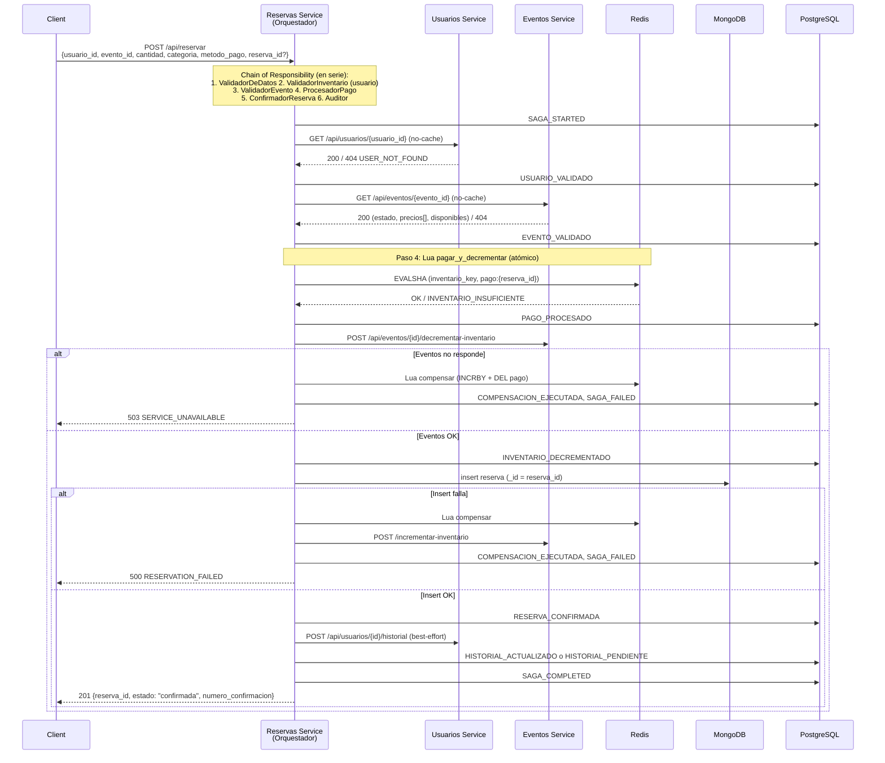
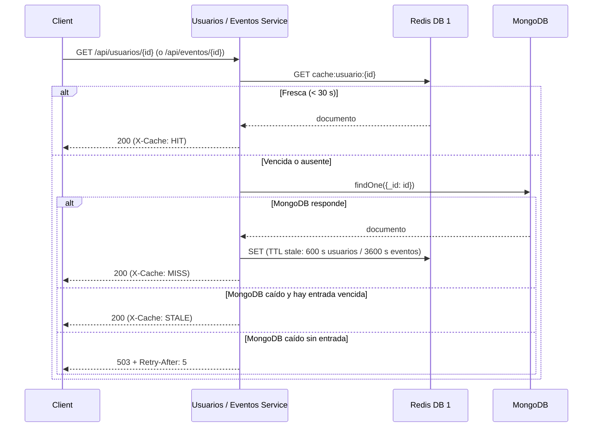
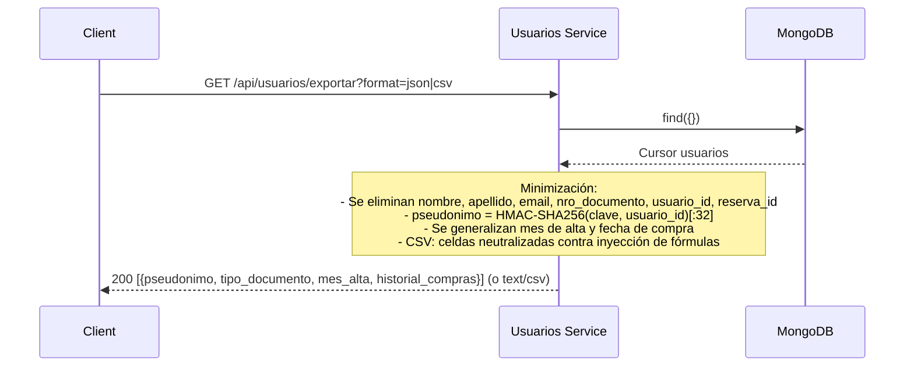

# Flujo de Datos — EventFlow

**Última revisión contra el código:** 2026-11-05

## Flujo Principal: Compra de Entrada (SAGA)

Si fallan los pasos 1 a 3 no se modificó nada: 404 / 409 / 422 / 503 y `SAGA_FAILED`, sin compensación. Un reintento con el mismo `reserva_id` de una reserva ya confirmada devuelve **200** sin volver a cobrar.

---

## Flujo: Lectura de Usuario o Evento (caché AP)

Con `Cache-Control: no-cache` (lo usa la SAGA) se lee siempre de MongoDB (`X-Cache: BYPASS`). Las escrituras que cambian el dato (inventario, historial) invalidan la entrada; los 404 no se cachean.

---

## Flujo: Exportación Anonimizada

---

## Flujo: Escritura del Event Log

`insert_event_log(event_type, aggregate_id, payload, correlation_id)` → `INSERT INTO event_log (event_type, aggregate_id, aggregate_type, payload, correlation_id)`; `id` y `timestamp` los pone PostgreSQL. La función atrapa sus errores: si PostgreSQL falla, la compra sigue.

Eventos: `SAGA_STARTED`, `USUARIO_VALIDADO`, `EVENTO_VALIDADO`, `PAGO_PROCESADO`, `INVENTARIO_DECREMENTADO`, `RESERVA_CONFIRMADA`, `HISTORIAL_ACTUALIZADO` / `HISTORIAL_PENDIENTE`, `SAGA_COMPLETED`, `SAGA_FAILED`, `COMPENSACION_EJECUTADA`.

---

## Resumen de Flujos por Consistencia

| Flujo | Consistencia | Medido | Patrón |
|-------|--------------|--------|--------|
| Lectura usuario / evento | Eventual (AP) | p50 ≈ 8-10 ms local | Caché stale-if-error + MongoDB |
| Listar usuarios / reservas | Eventual | — | Paginado (`skip`, `limit` ≤ 100) |
| Compra de entrada | **Fuerte** | ≈ 100 ms aislada; satura en ≈ 50 req/s | SAGA + Redis Lua |
| Export anonimizado | Eventual | — | Minimización + HMAC |

---

## Datos que Fluyen Entre Servicios

| Origen → Destino | Datos | Frecuencia |
|------------------|-------|------------|
| Reservas → Usuarios | `GET` usuario (validación); `POST historial` (compra) | Por reserva |
| Reservas → Eventos | `GET` evento; `decrementar-inventario` (y `incrementar` al compensar) | Por reserva |
| Reservas → Redis | `pago:{reserva_id}`, `evento:{id}:categoria:{cat}:disponibles` | Por reserva (atómico) |
| Reservas → MongoDB | Documento de reserva con `saga_log` | Por reserva exitosa |
| Reservas → PostgreSQL | Un evento por paso | Por paso de la SAGA |

---

## Consideraciones de Rendimiento

1. **Validaciones en serie**: la cadena valida usuario y después evento (no en paralelo).
2. **Redis Lua**: pago + inventario en una sola operación atómica (un round-trip).
3. **Índices MongoDB** (reales):
   - `usuarios`: `email` (único), `nro_documento` (único), `creado_en`, `tipo_documento`, `nombre`
   - `eventos`: `nombre` (único), `estado`, `creado_en`, `{estado, creado_en}`
   - `reservas`: `usuario_id`, `evento_id`, `estado`, `creado_en`, `{usuario_id, creado_en}`, `{evento_id, estado}`, `numero_confirmacion` (único), `{estado, creado_en}` y TTL de 24 h para `pendiente`/`fallida`
4. **Clientes HTTP**: `httpx.AsyncClient` reutilizado, 3 reintentos con backoff y circuit breaker.
