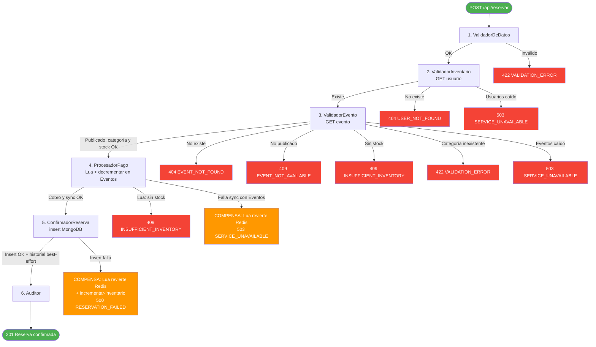

# Flujo SAGA — Compra de Entradas EventFlow

**Última revisión contra el código:** 2026-11-05 (`reservas-service/src/chain/validators.py`, `services/redis_pago.py`, `services/saga_orchestrator.py`)

## Visión General

El **Servicio de Reservas y Pagos** es el **orquestador** de la SAGA. La ejecuta como una Chain of Responsibility de 6 handlers en serie; las compensaciones están dentro de los handlers 4 y 5 (los únicos que modifican estado en otros sistemas).

---

## Diagrama de Flujo SAGA



---

## Pasos

| Paso | Handler | Acción | Servicio/BD | Si falla |
|------|---------|--------|-------------|----------|
| 1 | **ValidadorDeDatos** | Validar request (cantidad > 0, campos) | Local (Pydantic + handler) | 422, nada que deshacer |
| 2 | **ValidadorInventario** | `GET /api/usuarios/{id}` con `Cache-Control: no-cache` | Usuarios Service | 404 / 503, nada que deshacer |
| 3 | **ValidadorEvento** | `GET /api/eventos/{id}` (no-cache): estado `publicado`, categoría existente, `disponibles >= cantidad` | Eventos Service | 404 / 409 / 422 / 503, nada que deshacer |
| 4 | **ProcesadorPago** | Lua `pagar_y_decrementar` (cobro + decremento atómicos) y después `POST /api/eventos/{id}/decrementar-inventario` | Redis + Eventos | Si falla la sincronización: Lua `compensar_pago` → 503 |
| 5 | **ConfirmadorReserva** | Insert en `eventflow.reservas` (`_id = reserva_id`, con `saga_log`) y registro del historial en Usuarios (best-effort) | MongoDB + Usuarios | Si falla el insert: Lua `compensar_pago` + `incrementar-inventario` → 500 |
| 6 | **Auditor** | `SAGA_COMPLETED` en `event_log` | PostgreSQL | Solo warning: la reserva ya está confirmada |

Cada paso también escribe su evento en `event_log` (ver [[event-sourcing-cqrs]]). Esas escrituras atrapan sus propios errores: PostgreSQL caído no aborta la compra.

---

## Compensaciones

| Fallo en | Qué ya se había hecho | Compensación | Respuesta |
|----------|----------------------|--------------|-----------|
| Pasos 1 a 3 | Nada | Ninguna | 404 / 409 / 422 / 503 |
| Paso 4: falla la sincronización con Eventos | Cobro + decremento en Redis | Lua `compensar_pago`: `INCRBY` del inventario y `DEL pago:{reserva_id}` | 503 `SERVICE_UNAVAILABLE` |
| Paso 5: falla el insert en MongoDB | Redis + inventario en Eventos | Lua `compensar_pago` + `POST /api/eventos/{id}/incrementar-inventario` | 500 `RESERVATION_FAILED` |
| Historial en Usuarios | — | Ninguna: es best-effort, queda `HISTORIAL_PENDIENTE` | 201 igual |
| Paso 6 / event_log | — | Ninguna: solo warning | 201 igual |

Cada compensación registra `COMPENSACION_EJECUTADA` (`paso_compensado`, `accion`, `resultado`) y la SAGA termina con `SAGA_FAILED`. La vista `compensaciones_por_tipo` las agrupa por paso.

La demo dispara la compensación del paso 4 de forma determinista con `POST /api/reservar?simular_fallo=sync_pago` (el código de compensación es el mismo que ante una caída real).

---

## Lua: `pagar_y_decrementar` (paso 4)

`KEYS[1] = evento:{evento_id}:categoria:{categoria}:disponibles`, `KEYS[2] = pago:{reserva_id}`.

```lua
local inventario_key = KEYS[1]
local pago_key = KEYS[2]
local cantidad = tonumber(ARGV[1])
local seed = tonumber(ARGV[2])          -- disponibles según Eventos, si la clave aún no existe
local usuario_id = ARGV[3]
local evento_id = ARGV[4]
local monto = ARGV[5]
local metodo_pago = ARGV[6]
local categoria = ARGV[7]
local ttl = tonumber(ARGV[8])           -- 90 días

-- Idempotencia: si esta reserva_id ya pagó, no volver a decrementar.
if redis.call('EXISTS', pago_key) == 1 then
    local ya_pagado = tonumber(redis.call('HGET', pago_key, 'cantidad'))
    return {1, ya_pagado}
end

redis.call('SETNX', inventario_key, seed)
local disponible = tonumber(redis.call('GET', inventario_key))

if disponible < cantidad then
    return {-2, disponible}               -- INVENTARIO_INSUFICIENTE
end

redis.call('DECRBY', inventario_key, cantidad)
redis.call('HSET', pago_key,
    'usuario_id', usuario_id, 'evento_id', evento_id, 'cantidad', ARGV[1],
    'monto', monto, 'metodo_pago', metodo_pago, 'categoria', categoria,
    'inventario_key', inventario_key, 'estado', 'confirmado')
redis.call('EXPIRE', pago_key, ttl)

return {1, disponible - cantidad}
```

Redis ejecuta un script a la vez: chequear y decrementar no pueden intercalarse entre dos compradores, por eso no hay doble venta (verificado con JMeter: 300 intentos contra stock 50 → exactamente 50 ventas).

## Lua: `compensar_pago`

```lua
local pago_key = KEYS[1]
local inventario_key = redis.call('HGET', pago_key, 'inventario_key')
local cantidad = redis.call('HGET', pago_key, 'cantidad')

if not inventario_key then
    return 0                              -- ya compensado o nunca pagado: idempotente
end

redis.call('INCRBY', inventario_key, tonumber(cantidad))
redis.call('DEL', pago_key)
return 1
```

La cantidad y la clave del inventario salen del propio registro del pago, así que la compensación devuelve exactamente lo que se descontó.

---

## Eventos de la SAGA (event_log)

| Evento | Cuándo | Siguiente |
|--------|--------|-----------|
| `SAGA_STARTED` | Al empezar | `USUARIO_VALIDADO` |
| `USUARIO_VALIDADO` | Paso 2 OK | `EVENTO_VALIDADO` |
| `EVENTO_VALIDADO` | Paso 3 OK | `PAGO_PROCESADO` |
| `PAGO_PROCESADO` | Paso 4: cobro OK en Redis (antes de sincronizar con Eventos) | `INVENTARIO_DECREMENTADO`, o `COMPENSACION_EJECUTADA` si la sincronización falla |
| `INVENTARIO_DECREMENTADO` | Paso 4: Eventos sincronizado | `RESERVA_CONFIRMADA` |
| `RESERVA_CONFIRMADA` | Paso 5: insert OK | `HISTORIAL_ACTUALIZADO` / `HISTORIAL_PENDIENTE` |
| `SAGA_COMPLETED` | Paso 6 | — |
| `COMPENSACION_EJECUTADA` | Paso 4 o 5 compensado | `SAGA_FAILED` |
| `SAGA_FAILED` | Cualquier fallo | — |

No hay un estado "COMPENSATING": la compensación es inline y sincrónica dentro del handler.

---

## Manejo de Errores

| Error | HTTP | Compensación | ¿Reintentar? |
|-------|------|--------------|--------------|
| Datos inválidos | 422 `VALIDATION_ERROR` | Ninguna | No (corregir request) |
| Usuario no encontrado | 404 `USER_NOT_FOUND` | Ninguna | No |
| Evento no encontrado | 404 `EVENT_NOT_FOUND` | Ninguna | No |
| Evento no publicado | 409 `EVENT_NOT_AVAILABLE` | Ninguna | No |
| Inventario insuficiente | 409 `INSUFFICIENT_INVENTORY` | Ninguna | No |
| Usuarios/Eventos caído (pasos 2-3) | 503 `SERVICE_UNAVAILABLE` | Ninguna | Sí, mismo `reserva_id` |
| Falla sync con Eventos (paso 4) | 503 `SERVICE_UNAVAILABLE` | Lua revierte Redis | Sí, mismo `reserva_id` |
| Falla insert MongoDB (paso 5) | 500 `RESERVATION_FAILED` | Lua + incrementar-inventario | Sí, mismo `reserva_id` |
| PostgreSQL caído | — (la compra sigue) | — | — |

Las llamadas a Usuarios y Eventos se reintentan 3 veces (0,5 / 1 / 2 s) ante timeout o 5xx; con 5 fallos seguidos el circuit breaker abre 30 s y rechaza al instante.

---

## Idempotencia

- **Clave**: `reserva_id` (UUID v4); el cliente puede mandarlo, si no se genera.
- **Antes de la cadena**: si ya existe la reserva en MongoDB, se responde **200** con ella (sin ejecutar la SAGA).
- **Redis**: `pago:{reserva_id}` existente → el Lua no vuelve a decrementar.
- **MongoDB**: `_id = reserva_id`.
- **Historial**: `$ne` sobre `historial_compras.reserva_id` evita duplicar la compra.
