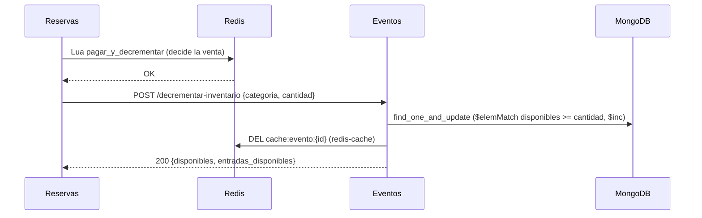

# Servicio de Eventos

## Responsabilidad

Gestiona los eventos (fecha, ubicación, precios por categoría) y su inventario de entradas, que Reservas descuenta en cada compra.

Revisado contra el código: 2026-11-05.

---

## Tecnologías

- **Framework**: FastAPI (Python 3.11)
- **Base de Datos**: MongoDB (`eventflow.eventos`)
- **Caché**: Redis `redis-cache` (`cache:evento:{id}`, stale-if-error)
- **Puerto**: 8002
- **Documentación**: http://localhost:8002/docs

---

## Modelo de Datos

```json
{
  "_id": "UUID",
  "nombre": "string (único)",
  "estado": "borrador | publicado | cancelado | finalizado",
  "fecha": "ISODate (UTC)",
  "aforo_total": "int",
  "entradas_disponibles": "int",
  "precios": [
    { "categoria": "string", "precio": "Decimal (2 decimales)", "disponibles": "int" }
  ],
  "ubicacion": { "ciudad": "string", "pais": "string", "direccion": "string | null" },
  "creado_en": "ISODate",
  "actualizado_en": "ISODate"
}
```

Detalle en [[event-schema]].

### Índices

```javascript
db.eventos.createIndex({ nombre: 1 }, { unique: true })
db.eventos.createIndex({ estado: 1 })
db.eventos.createIndex({ creado_en: 1 })
db.eventos.createIndex({ estado: 1, creado_en: -1 })
```

---

## Endpoints

| Método | Ruta | Descripción | Consistencia |
|--------|------|-------------|--------------|
| GET | `/health` | Health check | — |
| GET | `/metrics` | Prometheus | — |
| POST | `/api/eventos` | Crear evento | Fuerte |
| GET | `/api/eventos/{evento_id}` | Obtener evento (caché AP, `X-Cache`) | Eventual |
| POST | `/api/eventos/{evento_id}/decrementar-inventario` | Descontar entradas (SAGA paso 4) | Fuerte |
| POST | `/api/eventos/{evento_id}/incrementar-inventario` | Devolver entradas (compensación) | Fuerte |

Request/response de cada uno en [[eventos-endpoints]]. No hay listado ni modificación/borrado de eventos.

---

## Caché de lecturas (`services/lectura_cache.py`)

```
GET /api/eventos/{id}
  entrada fresca (< 30 s)        → 200, X-Cache: HIT
  vencida o ausente              → lee MongoDB, guarda la copia (1 h) → 200, X-Cache: MISS
  MongoDB caído + copia vencida  → 200, X-Cache: STALE
  MongoDB caído sin copia        → 503 + Retry-After: 5
  Cache-Control: no-cache        → siempre MongoDB, X-Cache: BYPASS (lo usa la SAGA)
```

- Los 404 no se cachean.
- Decrementar o incrementar el inventario invalida la entrada.
- Si Redis falla, las lecturas van directo a MongoDB (y no se reintenta Redis por 5 s).
- No baja la latencia de un lookup por `_id` en local (≈10 ms con caché vs ≈8 ms sin); su valor es la disponibilidad.

---

## Validaciones

| Campo | Reglas |
|-------|--------|
| `nombre` | 1-200 chars, único (409) |
| `fecha` | ISO 8601, entre 1970 y 2100; se normaliza a UTC (no se exige que sea futura) |
| `aforo_total`, `entradas_disponibles` | ≥ 0; `entradas_disponibles ≤ aforo_total` |
| `precios` | Al menos uno; categorías únicas; `precio ≥ 0` con ≤ 2 decimales; `sum(disponibles) ≤ entradas_disponibles` |
| `estado` | Enum: borrador, publicado, cancelado, finalizado |

---

## Integración con Reservas Service

- **GET** `/api/eventos/{evento_id}` con `Cache-Control: no-cache` — paso 3: existe, está `publicado`, la categoría existe y hay stock.
- **POST** `/decrementar-inventario` — paso 4, después de que el Lua de Redis cobró. Si falla, Reservas revierte Redis.
- **POST** `/incrementar-inventario` — compensación del paso 5.



Redis decide la venta (atómico); MongoDB queda alineado en el mismo paso para que `GET /api/eventos/{id}` muestre el stock real.

---

## Testing

```bash
make test     # eventos: 93 tests (incluye contract testing con schemathesis)
```

---

## Referencias

- [[event-schema]] — Esquema detallado
- [[eventos-endpoints]] — Referencia OpenAPI
- [[saga-flow]] — Uso en SAGA
- [[consistency-strategy]] — Consistencia eventual en lecturas
