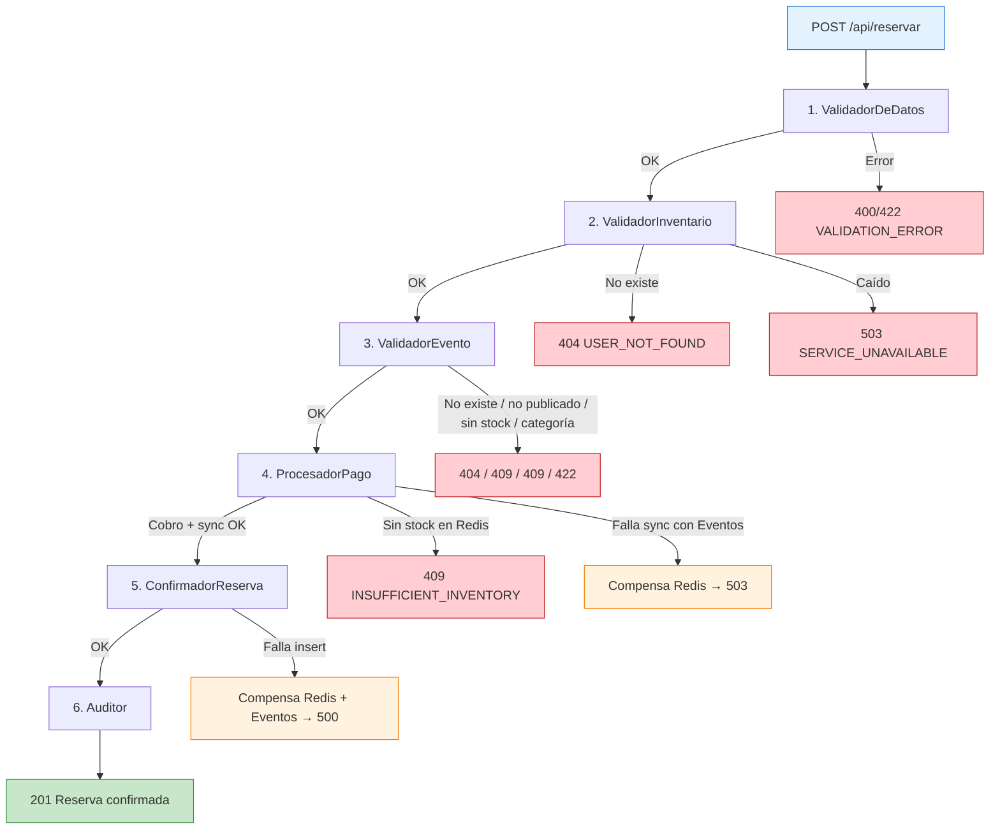

# Chain of Responsibility - Reservas Service

**Última revisión contra el código:** 2026-11-05 (`reservas-service/src/chain/handler.py`, `chain/validators.py`)

## Visión General

La SAGA de compra se ejecuta como una **cadena de 6 handlers**. Cada uno hace un solo paso sobre un `ReservaContext` compartido; si falla, deja el error en el contexto y la cadena se corta (los siguientes no corren).

---

## Diagrama de la Cadena



---

## Estructura Base (código real)

### `ReservaContext` (dataclass, `models/reserva.py`)

Viaja por toda la cadena y cada handler lo completa: `usuario_id`, `evento_id`, `cantidad`, `metodo_pago`, `categoria`, `reserva_id`, `correlation_id`, `usuario_data`, `evento_data`, `categoria_disponibles`, `precio_unitario`, `pago_data`, `reserva_data`, `error`, `error_code`, `status_code`, `saga_log`, `compensation_triggered`, `simular_fallo_sync`.

### `Handler` y `BaseHandler` (`chain/handler.py`)

```python
class Handler(ABC):
    def set_next(self, handler: "Handler") -> "Handler":
        self._next_handler = handler
        return handler

    async def _execute_next(self, context):
        if self._next_handler:
            return await self._next_handler.handle(context)
        return context

class BaseHandler(Handler):
    async def handle(self, context):
        if context.error or context.status_code >= 400:   # la cadena ya se cortó
            return context
        try:
            await self._process(context)                    # lógica propia del paso
        except Exception as e:
            context.error, context.status_code = str(e), 500
            self._add_saga_log(context, self._step_name, False, str(e))
            return context
        if context.error or context.status_code >= 400:
            return context
        return await self._execute_next(context)

    @abstractmethod
    async def _process(self, context) -> None: ...
```

Cada handler implementa solo `_process()`: hace su paso, agrega su entrada a `context.saga_log` (`paso`, `timestamp`, `exitoso`, `detalles`), registra su evento en `event_log` y mide su duración (`saga_step_duration`).

### Construcción (`ChainBuilder.build()` en `chain/validators.py`)

```python
validador_datos = ValidadorDeDatos()
validador_inventario = ValidadorInventario()
validador_evento = ValidadorEvento()
procesador_pago = ProcesadorPago()
confirmador_reserva = ConfirmadorReserva()
auditor = Auditor()

validador_datos.set_next(validador_inventario)
validador_inventario.set_next(validador_evento)
validador_evento.set_next(procesador_pago)
procesador_pago.set_next(confirmador_reserva)
confirmador_reserva.set_next(auditor)
return validador_datos
```

Los handlers no reciben dependencias por constructor: usan los módulos de servicio (`http_clients`, `redis_pago`, `mongo`, `postgresql`). Los tests los reemplazan con `patch`.

---

## Los 6 Handlers

| # | Handler | Qué hace | Errores que produce |
|---|---------|----------|---------------------|
| 1 | `ValidadorDeDatos` | UUIDs válidos, `cantidad > 0`, `metodo_pago` en la lista. Defensa en profundidad: Pydantic ya rechaza casi todo con 422 antes de la cadena | 400 `VALIDATION_ERROR` |
| 2 | `ValidadorInventario` | `get_usuario()` (HTTP con `no-cache`, reintentos, circuit breaker); `USUARIO_VALIDADO` | 404 `USER_NOT_FOUND`, 503 |
| 3 | `ValidadorEvento` | `get_evento()`; estado `publicado`; categoría en `precios[]`; `disponibles >= cantidad`; guarda `precio_unitario` y `categoria_disponibles`; `EVENTO_VALIDADO` | 404 `EVENT_NOT_FOUND`, 409 `EVENT_NOT_AVAILABLE`, 422 `VALIDATION_ERROR`, 409 `INSUFFICIENT_INVENTORY`, 503 |
| 4 | `ProcesadorPago` | Lua `pagar_y_decrementar`; `PAGO_PROCESADO`; `decrementar_inventario_evento()`; `INVENTARIO_DECREMENTADO`. Si la sincronización falla: Lua `compensar_pago` + `COMPENSACION_EJECUTADA` | 409 `INSUFFICIENT_INVENTORY`, 500 `PAYMENT_FAILED`, 503 |
| 5 | `ConfirmadorReserva` | Insert en `eventflow.reservas` (con `numero_confirmacion` y `saga_log`); `RESERVA_CONFIRMADA`; historial en Usuarios best-effort (`HISTORIAL_ACTUALIZADO` / `HISTORIAL_PENDIENTE`). Si el insert falla: Lua `compensar_pago` + `incrementar_inventario_evento()` + `COMPENSACION_EJECUTADA` | 500 `RESERVATION_FAILED` |
| 6 | `Auditor` | `SAGA_COMPLETED`. Si falla, solo warning | — |

Detalle de cada evento y su payload en [[reservation-schema]].

---

## Uso en el endpoint (`api/routes/reservas.py`)

```python
existing = await check_idempotency(solicitud.reserva_id)
if isinstance(existing, dict) and "_id" in existing:   # ya confirmada
    response.status_code = 200
    return ReservaResponse(...)

context = ReservaContext(..., reserva_id=solicitud.reserva_id,
                         simular_fallo_sync=(simular_fallo == "sync_pago"))
orchestrator = SagaOrchestrator(chain=ChainBuilder.build(),
                                compensation_handlers={4: ..., 5: ...})
context = await orchestrator.execute(context)          # SAGA_STARTED ... SAGA_FAILED/COMPLETED
if context.error:
    raise EventFlowHTTPException(context.error_code, ...)   # RFC 7807
return ReservaResponse(...)                             # 201
```

---

## Ventajas

| Beneficio | En este código |
|-----------|----------------|
| **Una responsabilidad por handler** | Validar usuario, validar evento, cobrar, confirmar y auditar están separados |
| **Testabilidad** | Cada handler se prueba con un contexto armado y los servicios mockeados (`tests/unit/test_handlers.py`) |
| **Corte temprano** | Un error en el paso 2 o 3 evita tocar Redis o MongoDB: no hay nada que compensar |
| **Compensación localizada** | Solo los handlers que modifican estado (4 y 5) saben deshacerlo |
| **Trazabilidad** | `saga_log` en la reserva + un evento por paso en PostgreSQL, con `correlation_id` |

---

## Referencias

- [[saga-flow]] - Integración con la SAGA y Lua
- [[saga-pattern]] - Orquestador
- [[event-sourcing-cqrs]] - Eventos que emite cada handler
- [[reservation-schema]] - `ReservaContext` y esquemas
